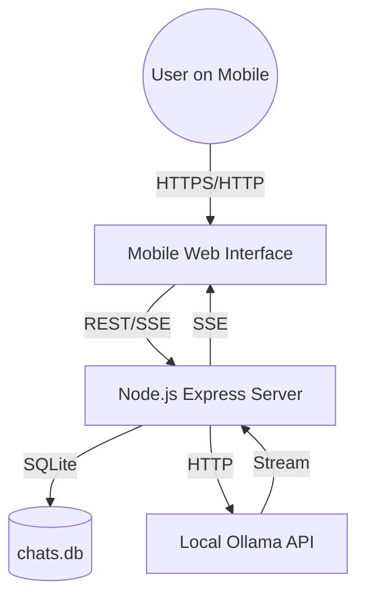

# Ollama Phone Chat - Code Documentation

## Project Architecture
Ollama Phone Chat is a lightweight, mobile-first web application that acts as a bridge to your local [Ollama](https://ollama.com/) instance. It consists of a Node.js backend and a Vanilla JS frontend, using SQLite for persistent chat storage.

### High-Level Component Diagram

---

## File & Folder Structure

| Path | Description |
| :--- | :--- |
| `server.js` | HTTP entry point: routing, auth, validation, Ollama detection, SSE streaming, lifecycle. |
| `config.js` | Central configuration loaded from environment variables (port, host, mode, timeouts, limits). |
| `db.js` | Database initialization, migrations, encryption, and the chat/message repository. |
| `public/` | Static files for the frontend. |
| `public/index.html` | The main UI structure (mobile-first): sidebar, header, transcript, composer, modals. |
| `public/app.js` | Frontend logic: state management, SSE handling, UI rendering, theming, and font scaling. |
| `public/styles.css` | Design system, live theme tokens, responsive layouts, and typography presets. |
| `public/vendor/` | Vendored `marked` and DOMPurify bundles plus their licenses. |
| `public/vendor/fonts/` | Vendored WOFF2 display/body fonts and their OFL licenses (no CDN). |
| `data/` | Directory containing the SQLite database (`chats.db`). |
| `models_cache.json` | Local cache of Ollama models for offline/fallback mode. |
| `seed_prompt.txt` | Default system prompt template. |
| `start.bat` / `start.sh` | Cross-platform launcher scripts. |

---

## Core Modules & API

### Backend (`server.js`)
The backend is built with Express and provides the following API endpoints:

| Endpoint | Method | Description |
| :--- | :--- | :--- |
| `/api/status` | GET | Public connection status, LAN IP, port, auth/cloud availability, version. |
| `/api/health` | GET | Public liveness probe (version, mode, uptime). |
| `/api/login` | POST | Password check, rate limited per client IP. |
| `/api/auth/verify` | GET | Protected endpoint used by the UI to validate a saved password. |
| `/api/models` | GET | Lists available models from local/cloud Ollama with a cache fallback (`source`, `stale`). |
| `/api/chats` | GET | Fetches all chat histories from the database. |
| `/api/chats` | POST | Creates a chat (title/model default safely when omitted). |
| `/api/chats/:id`| GET | Fetches details and messages for a specific chat. |
| `/api/chat` | POST | Validated streaming chat endpoint using Server-Sent Events (SSE). |
| `/api/chats/:id`| DELETE| Deletes a chat; returns 404 when it does not exist. |

All request bodies are validated before use. Invalid input returns a JSON `400` instead of throwing, and unexpected errors return a generic `500` without stack traces. Unknown API routes return JSON `404`.

### Database (`db.js`)
Uses `sqlite3` to manage two primary tables plus a small metadata table:
- **`chats`**: Stores chat metadata (title, model, timestamps). Titles are encrypted when `APP_PASSWORD` is set.
- **`messages`**: Stores message contents, roles (user/assistant), optional "thinking" blocks, and an optional `client_message_id` used to make retries idempotent.
- **`meta`**: Stores key-verification metadata.

The module exposes a repository API (`createChat`, `listChats`, `getChat`, `getMessages`, `addMessage`, `touchChat`, `deleteChat`) which is the only layer that encrypts and decrypts data. Initialization enables `foreign_keys`, WAL journaling, a 5-second busy timeout, an index on `messages(chat_id, created_at, id)`, and an idempotency index on `(chat_id, client_message_id)`. `initDb()` must be awaited before the HTTP server starts listening.

---

## Data Flow

1.  **Detection**: On startup, the server attempts to detect a local Ollama instance at `http://localhost:11434`.
2.  **Connection**: The server generates a QR code in the terminal for the user to scan with their phone.
3.  **Interaction**:
    -   When a user sends a message, `app.js` sends a `POST` request to `/api/chat` with a `clientMessageId`.
    -   The server validates the payload, calls Ollama, and only after Ollama accepts the request creates the chat and stores the user message. Failed requests leave no empty chats behind.
    -   The response is streamed back as **Server-Sent Events (SSE)** with a 15-second heartbeat. Client disconnects abort the upstream request, and partial replies are still persisted.
    -   The assistant message is saved once, when Ollama reports `done`.
4.  **UI Updates**: `app.js` parses the SSE stream, renders Markdown using `marked`, and sanitizes output with `DOMPurify`.

### Frontend (`public/app.js`)
- Rendering is DOM-based. Chat titles, user messages, and thinking blocks use `textContent`; assistant Markdown is sanitized with `DOMPurify`, so stored model output cannot inject HTML or scripts.
- The SSE reader decodes bytes incrementally, supports multi-line `data:` events, and ignores heartbeat comments and non-JSON noise.
- Markdown is repainted at most once per animation frame, which keeps long replies responsive on phones without re-parsing the whole document for every token.
- Sending uses a per-message `clientMessageId` so retries cannot duplicate the user turn. Context is trimmed to the last 40 messages / ~24k characters.
- The send button becomes a stop button while streaming and aborts the fetch; the server keeps the partial reply.
- A `401` clears the stored password and returns to the login screen. A saved password is verified against `/api/auth/verify` before use.
- Timestamps from SQLite are treated as UTC. Interactions are keyboard accessible, and toggles expose `aria-pressed`.
- The layout is a flex column (`header` / `#chat-container` / `footer`) with no absolute overlays, so the transcript owns the scroll and the composer never covers the last message. Under 900px the sidebar becomes an overlay drawer.
- Web search, thinking, and quality controls live in a composer tools row. Chips are shown only for models whose names advertise the capability, and state is expressed with classes (`is-on`) plus `aria-pressed` rather than inline colors.
- Themes: the stylesheet defines a dark "signal desk" palette and a warm-paper light palette. `auto` follows `prefers-color-scheme`; the sidebar toggle cycles `auto → light → dark` and stores the choice in `localStorage` under `theme`.
- The empty state is built in the DOM (brand mark, kicker, model name, suggestion chips) and is re-rendered whenever the model changes with no messages loaded. Suggestion chips fill and focus the composer without sending.
- A scroll-to-latest button appears when the transcript is more than 160px from the bottom. Streaming replies get a blinking caret class that is removed when the stream settles, and message actions (time, copy) are siblings of the bubble so copying never includes UI chrome.
- The model picker is grouped into **Local**, **Cloud · Free**, and **Cloud · Paid**, and each cloud group carries a tier chip and count. `FREE_CLOUD_MODELS` near the top of `app.js` lists the cloud models that draw from free usage; names are compared with any `:cloud` / `-cloud` suffix removed, because the CLI (`gemma4:cloud`) and the cloud API (`gemma4:31b`) label the same model differently. The empty state repeats the cost of the selected cloud model.
- Typography is self-hosted: Bricolage Grotesque (display) and Instrument Sans (body/UI) are preloaded from `public/vendor/fonts/`. There are no font or script requests outside the app origin.

---

## Dependencies

### Runtime
- `express` 5.x: Web server framework.
- `sqlite3` 6.x: Database engine (requires Node.js 20.17+).
- `qrcode-terminal`: Generates QR codes for easy mobile connection.
- `dotenv`: Environment variable management.
- `fetch`: Built into Node.js (no external HTTP client dependency).

### Frontend
- `marked` 18.1.2: Markdown parsing, vendored at `public/vendor/marked.umd.js` (MIT).
- `DOMPurify` 3.4.17: HTML sanitization, vendored at `public/vendor/purify.min.js` (Apache-2.0 OR MPL-2.0).
- Bricolage Grotesque Variable 5.3.0 and Instrument Sans Variable 5.3.0: display and body faces, vendored as latin-subset WOFF2 at `public/vendor/fonts/` (SIL OFL 1.1).

All of them are served locally: the UI does not need internet access to load, and `script-src 'self'` / `font-src 'self'` can be enforced. Licenses and checksums are recorded in [THIRD_PARTY_NOTICES.md](./THIRD_PARTY_NOTICES.md).

---

## Testing

`npm test` runs the `node:test` suite (Node.js 20.17+). The tests isolate all state: each file uses a temporary SQLite database and model cache via `DB_PATH`/`MODELS_CACHE`, an ephemeral HTTP port, and a mock Ollama server, so no real chats or network services are touched.

- `test/db.test.js`: encryption/decryption, `ag:` payloads, legacy CBC reads, retry idempotency, cascade deletes, and wrong-password markers (verified in a child process).
- `test/db-plaintext.test.js`: documented plaintext mode when `APP_PASSWORD` is unset.
- `test/server.test.js`: status/LAN reporting, security headers, CSP, vendored assets, authentication, payload validation, streaming and persistence, retry idempotency, upstream failures, JSON errors, and login rate limiting.
- `test/frontend.test.js`: loads the real HTML and vendored bundles in jsdom, checks that stored titles stay inert, verifies Markdown sanitization, streams a reply, exercises the stop button, and covers saved-password handling.

`jsdom` is a development-only dependency for the frontend tests.

---

## Configuration

Environment variables are read by `config.js`. Copy `.env.example` to `.env` and adjust what you need; every variable is optional and the example lists the defaults.

| Variable | Default | Purpose |
| :--- | :--- | :--- |
| `PORT` | `3000` | HTTP port. |
| `HOST` | `0.0.0.0` | Bind address (use `127.0.0.1` for local-only). |
| `MODE` | `auto` | `auto`, `local`, or `cloud`. |
| `APP_PASSWORD` | unset | Enables authentication and at-rest encryption. |
| `OLLAMA_API_KEY` | unset | Required for cloud mode. |
| `OLLAMA_HOST` | `http://127.0.0.1:11434` | Local Ollama base URL. |
| `OLLAMA_CLOUD_URL` | `https://ollama.com/api` | Cloud API base URL. |
| `REQUEST_TIMEOUT_MS` | `120000` | Upstream chat timeout. |
| `DETECT_TIMEOUT_MS` | `3000` | Model/health probe timeout. |
| `OLLAMA_HEALTH_INTERVAL_MS` | `30000` | Auto-mode re-detection interval. |
| `MAX_BODY_SIZE` | `2mb` | JSON body limit. |
| `DB_PATH` | `data/chats.db` | SQLite file (useful for tests). |
| `MODELS_CACHE` | `models_cache.json` | Model cache path. |
| `LOGIN_MAX_ATTEMPTS` | `5` | Login attempts per window. |
| `LOGIN_WINDOW_MS` | `60000` | Login rate-limit window. |
| `TRUST_PROXY` | unset | Set to `1` when behind a trusted reverse proxy. |

### LAN address selection
The server scores non-internal IPv4 interfaces and deprioritizes virtual adapters (Hyper-V, WSL, Docker, VPNs) and 169.254 link-local addresses. `/api/status` returns the best `lanIp` plus up to five `lanIps`; startup prints alternative addresses and generates the QR code for the best candidate. Use `HOST` to restrict the bind address.

---

## Execution Flow
1.  **Launch**: Run `start.bat` or `npm start`.
2.  **Server Init**: `server.js` starts, initializes the database via `db.js`, and looks for Ollama.
3.  **Ready**: Terminal displays a QR code.
4.  **Client Connect**: Mobile browser opens the LAN IP; `app.js` initializes state and fetches models.
5.  **Chat**: User selects a model and starts chatting.
