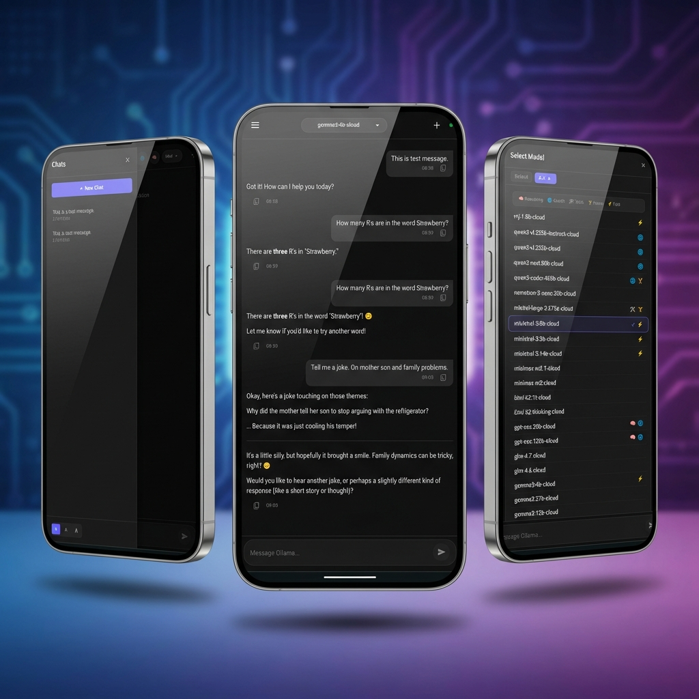

# Ollama Phone Chat

[](https://www.gnu.org/licenses/gpl-3.0)
[](https://nodejs.org/)

**Ollama Phone Chat** is a seamless bridge for chatting with local and cloud [Ollama](https://ollama.com/) models from your mobile devices. It transforms your desktop's AI capabilities into a private, mobile-first experience with zero configuration.



---

## 🚀 Key Features

-   **Zero-Config Connection**: Just scan the QR code in your terminal and start chatting.
-   **Mobile-First Design**: A premium, responsive "signal desk" interface built for thumbs: centred composer, scroll-to-latest, and a slide-over history drawer.
-   **Light & Dark Themes**: Six palettes — warm paper, herb green, petrol, plum ember, and deep midnight — following your system by default. The sidebar toggle cycles Auto → Light → Sage → Dark → Ember → Midnight, and the phone's browser chrome follows along.
-   **Self-Hosted Typography**: Bricolage Grotesque and Instrument Sans ship with the app, so the interface keeps its character offline and under a strict CSP.
-   **"Thinking" Support**: Visualize the reasoning process of models (like DeepSeek) in real-time.
-   **Stop Generation**: Cancel a streaming reply at any time without losing the partial answer.
-   **Safe Rendering**: Model output is sanitized and titles are rendered as text, not HTML.
-   **Persistent History**: Locally stored SQLite database keeps your chats private and accessible.
-   **Quality Presets**: Adjust model performance (High/Med/Low) directly from your phone.
-   **Cloud Cost Clarity**: The model picker lists free-tier cloud models in their own group at the top, followed by local models and plan-only cloud models, so the cost of a choice is visible before you send. The paid group links to [ollama.com/settings](https://ollama.com/settings) for credits or upgrades, and the empty state repeats the tier for the selected cloud model.
-   **Font Size Controls**: Three text scales (12px / 14px / 16px) that rescale the whole interface, remembered across visits.
-   **Draft Autosave**: Unsent text is kept per conversation, restored when you come back, and flagged with a Draft badge in the history list.
-   **Encrypted History**: Messages and chat titles are encrypted at rest with AES-256-GCM and scrypt key derivation (requires `APP_PASSWORD`).
-   **Secure Access**: Lock your bridge with a password for safe LAN/WAN usage.
-   **Privacy First**: 100% local. Your data never leaves your home network.
-   **Offline-Ready UI**: Markdown rendering, sanitization, and both font families are vendored, so the interface loads without a CDN.

---

## 🛠️ Quick Start

1.  **Ensure Ollama is running** on your computer and that **Node.js 20.17 or newer** is installed.
2.  **Clone the repo**:
    ```bash
    git clone https://github.com/krishnakanthb13/ollama_phone_chat.git
    cd ollama_phone_chat
    ```
3.  **Install & Start**:
    ```bash
    npm install
    npm start
    ```
4.  **Connect**: Scan the QR code shown in your terminal with your phone.

### 🔒 Securing your Bridge
To enable encryption and password protection, add an `APP_PASSWORD` to your `.env` file:
```env
APP_PASSWORD=your_secret_password_here
```
Start from the commented template so you can see every supported setting:
```bash
cp .env.example .env
```
When set, new messages and chat titles are encrypted with **AES-256-GCM** using a key derived from your password with scrypt (per-install salt stored in `data/.key_salt`). Without `APP_PASSWORD`, history is stored unencrypted. Legacy AES-256-CBC rows written by v0.0.4 remain readable. Changing `APP_PASSWORD` makes previously encrypted rows unreadable, so back up the database before rotating the password.

---

### ⚙️ Configuration
Most settings have sensible defaults. See [Code Documentation](./CODE_DOCUMENTATION.md#configuration) for the full environment-variable table, including `OLLAMA_HOST`, `HOST`, timeouts, and test-friendly `DB_PATH`.

### 🧪 Development
Run `npm test` to execute the database, server integration, and frontend suites. Tests use temporary databases and ephemeral ports, so they never touch your real chat history.

---

## 📖 Documentation

-   [**Code Documentation**](./CODE_DOCUMENTATION.md): High-level architecture and module overview.
-   [**Design Philosophy**](./DESIGN_PHILOSOPHY.md): Why we built this and the principles behind it.
-   [**Contributing**](./CONTRIBUTING.md): How to report bugs and submit pull requests.
-   [**Security Policy**](./SECURITY.md): Security implementation details and recommendations.

---

## 🔒 Security Note
By default, this bridge is accessible to anyone on your Local Area Network (LAN). For security recommendations regarding public exposure, see our [Security Policy](./SECURITY.md).

---

## 📄 License
This project is licensed under the **GNU GPL v3** - see the [LICENSE](./LICENSE) file for details.

---

## 👤 Author
**Krishna Kanth B**  
- GitHub: [@krishnakanthb13](https://github.com/krishnakanthb13)
